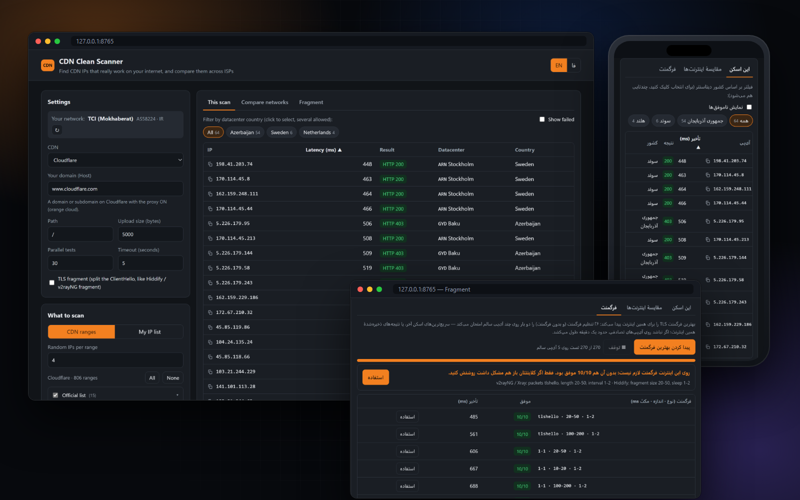
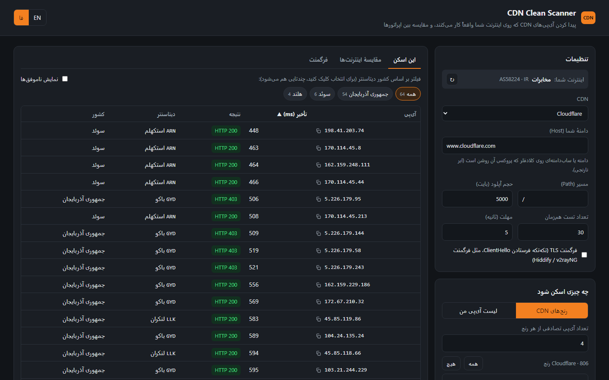
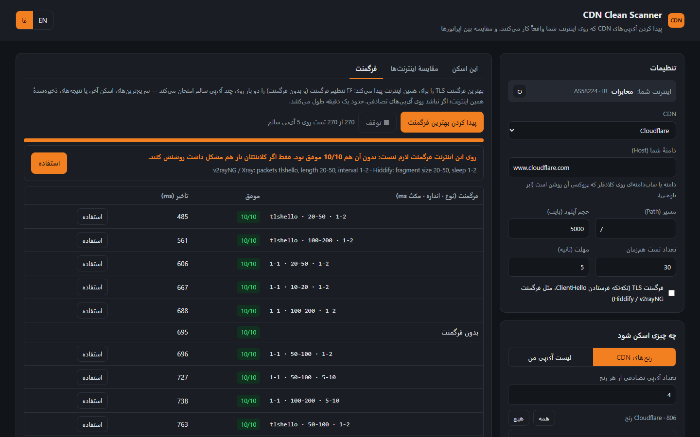

# CDN Clean Scanner

<a href="https://hits.sh/github.com/Plus98ir/CDN-Clean-Scanner/"></a> <a href="https://corenetbase.com/#support"></a>
<a href="https://github.com/Plus98ir/CDN-Clean-Scanner/releases/latest"></a>

<details>
<summary><b>☕ Support · حمایت</b> — USDT (TRC20) / TRX</summary>
<br>
<p align="center"></p>

```
TA53aFyGNfSAcrCaJi9QmA9x5W47nPJcf7
```

> [!WARNING]
> **TRON network only.** Sending from ERC20 / BEP20 will lose the funds.<br>
> **فقط شبکه‌ی TRON.** ارسال از ERC20 یا BEP20 پول را از بین می‌برد.

</details>

<div align="center">
<table><tr><td><a href="https://github.com/Plus98ir/CDN-Clean-Scanner/blob/main/README.md">🇺🇸 English</a></td><td><b>🇮🇷 فارسی</b></td></tr></table>
</div>

وب‌سایت: https://corenetbase.com/CDN-Clean-Scanner/



<div dir="rtl">

**اسکنر حرفه‌ای آی‌پی تمیز برای Cloudflare، Fastly، Gcore و Amazon CloudFront.** هر آی‌پی را با **ترافیک واقعی** روی اینترنت خود شما تست می‌کند، نشان می‌دهد **هر آی‌پی روی کدام اپراتور** کار می‌کند (همراه اول، ایرانسل، مخابرات، رایتل و …)، **بهترین تنظیم فرگمنت** را برای اینترنت شما پیدا می‌کند و آی‌پی‌های تمیز را مستقیم در پنل **Hiddify یا 3x-ui** می‌نویسد.

پینگ کافی نیست: بعضی اپراتورها اجازه می‌دهند پینگ و هندشیک TLS رد شود، اما بعد از حدود ۱٫۳ کیلوبایت آپلود اتصال را قطع می‌کنند. این اسکنر با دامنهٔ خودتان به‌عنوان SNI به هر آی‌پی وصل می‌شود و یک آپلود واقعی (پیش‌فرض ۵ کیلوبایت) می‌فرستد. فقط آی‌پی‌هایی که جواب بدهند نگه داشته می‌شوند.

### دانلود

- **ویندوز:** [CDN-Clean-Scanner.exe](https://github.com/Plus98ir/CDN-Clean-Scanner/releases/latest/download/CDN-Clean-Scanner.exe) را دانلود کنید و رویش دوبار کلیک کنید؛ پایتون لازم نیست. اگر ویندوز هشدار داد، More info و بعد Run anyway را بزنید.
- **اندروید:** [CDN-Clean-Scanner.apk](https://github.com/Plus98ir/CDN-Clean-Scanner/releases/latest/download/CDN-Clean-Scanner.apk) را نصب کنید (اجازهٔ نصب از منابع ناشناس را بدهید؛ روت لازم نیست). اگر اجازهٔ اعلان خواست، Allow بزنید.

برنامه خودش نسخهٔ جدید را چک می‌کند و با بنر (و روی اندروید با اعلان) همراه لیست تغییرات خبر می‌دهد.

قبل از اسکن **فیلترشکن را خاموش کنید**؛ وگرنه فیلترشکن تست می‌شود، نه اینترنت شما.

### امکانات

- ⬆️ **تست با آپلود واقعی:** آی‌پی‌هایی که فقط هندشیک را رد می‌کنند حذف می‌شوند.
- 📶 **نتیجه برای هر اپراتور:** اپراتور با شمارهٔ AS خودکار تشخیص داده می‌شود؛ در «مقایسهٔ اینترنت‌ها» هر اپراتور یک ستون است.
- 🔌 **تست کامل:** برای کانفیگ‌های ws و httpupgrade یک WebSocket واقعی روی مسیر کانفیگ باز می‌کند (جواب 101) و داده رفت‌وبرگشت می‌فرستد تا IPهایی که تست ساده را رد می‌کنند ولی در کلاینت پینگ نمی‌دهند پیدا شوند.
- 🧩 **فرگمنت TLS:** ارسال تکه‌تکهٔ ClientHello (حالت `tlshello` یا TCP `1-1`، مثل v2rayNG و Hiddify) تا DPI نتواند SNI را بخواند.
- 🎯 **پیدا کردن بهترین فرگمنت:** ۲۶ تنظیم فرگمنت و حالت بدون فرگمنت را امتحان می‌کند و بهترین را با مقدارهای آمادهٔ کلاینت می‌دهد.
- 🛰️ **پنل Hiddify و 3x-ui:** دامنه‌ها و کانفیگ‌ها را با path خودکار می‌آورد و بهترین آی‌پی‌های هر اپراتور را با یک کلیک در پنل می‌نویسد.
- 🌐 **۴ CDN و حدود ۱۴۰۰ رنج**، 📍 **شهر و کشور دیتاسنتر** با فیلتر کشور و «پیدا کردن بیشتر».
- 🔒 **کاملاً محلی:** فقط روی 127.0.0.1 اجرا می‌شود؛ لینک، توکن و رمز پنل فقط برای همان درخواست استفاده می‌شوند.

### فرگمنت

۱. یک اسکن معمولی بزنید تا چند آی‌پی سالم پیدا شود (اگر هیچ‌کدام رد نشد، تیک «فرگمنت TLS» را بزنید و دوباره اسکن کنید).<br>
۲. در تب **فرگمنت**، «پیدا کردن بهترین فرگمنت» را بزنید (حدود یک دقیقه).<br>
۳. بهترین تنظیم با مقدارهای آماده نشان داده می‌شود؛ «استفاده» آن را برای اسکن‌های بعدی تنظیم می‌کند. اگر بدون فرگمنت هم همه رد شوند، همین را می‌گوید.

### ارسال آی‌پی‌ها به پنل

در قدم ۵، **ذخیرهٔ آی‌پی‌ها**، بخش **ارسال به پنل** (اتصال به پنل در قدم ۲ است):

- **Hiddify:** لینک ادمین را بدهید. همهٔ دامنه‌ها با حالتشان می‌آیند و مشخص می‌شود کدام پشت CDN است. آی‌پی‌ها به‌شکل «IP اپراتور» در فیلد CDN IP نوشته می‌شوند و هیدیفای به هر کاربر آی‌پی اپراتور خودش را می‌دهد.
- **3x-ui (ثنایی):** آدرس پنل و **توکن API** (تنظیمات ← امنیت ← API Token) یا نام کاربری و رمز. کانفیگ‌های ws، httpupgrade، xhttp و grpc با دامنه و path می‌آیند. آی‌پی‌ها در **گروه Host** همان کانفیگ نوشته می‌شوند و هر اپراتور گروه خودش را می‌گیرد تا اسمش روی کانفیگ بیاید (کانفیگ بدون گروه، گروه جدید می‌گیرد؛ پنل‌هایی که گروه Host ندارند از لیست **External Proxy** استفاده می‌کنند). هر گروهی که آی‌پی بگیرد روشن می‌شود و دامنهٔ شما SNI آن می‌شود، و فرگمنتی که پیدا کرده‌اید را می‌توانید در گروه همان اپراتوری که رویش پیدا شده ذخیره کنید. کلاینت‌ها دست نمی‌خورند. بهتر است آدرس `https://` پنل را بزنید: با `http://` اطلاعات ورود بدون رمزنگاری از اپراتور رد می‌شود.
- «استفاده برای اسکن» دامنه و path همان کانفیگ را در تنظیمات اسکن می‌نویسد.

### مقایسهٔ اپراتورها

۱. روی اینترنت اول (مثلاً وای‌فای مخابرات) یک اسکن معمولی انجام دهید.<br>
۲. به اینترنت دیگری وصل شوید (مثلاً هات‌اسپات گوشی با سیم‌کارت همراه اول) و دکمهٔ ↻ کنار «اینترنت شما» را بزنید.<br>
۳. در تب «مقایسهٔ اینترنت‌ها» دکمهٔ «تست همین‌ها روی این اینترنت» را بزنید.<br>
۴. برای ایرانسل و بقیه تکرار کنید. با کلیک روی نام اپراتورها فقط آی‌پی‌هایی می‌مانند که روی همهٔ آن‌ها کار می‌کنند.

### تصاویر

</div>

| نتیجهٔ اسکن | پیدا کردن بهترین فرگمنت |
|---|---|
|  |  |
