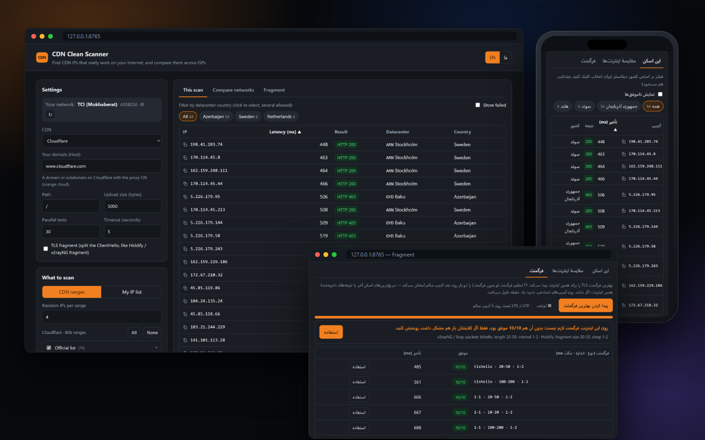
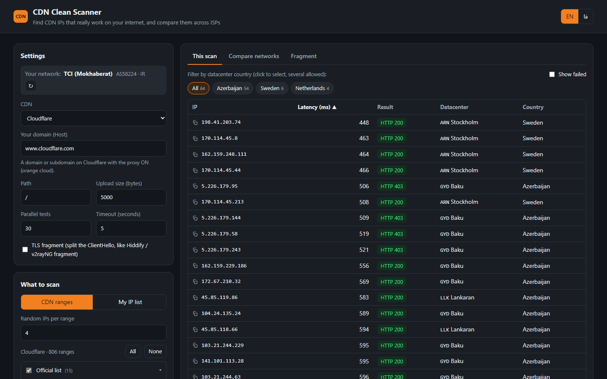
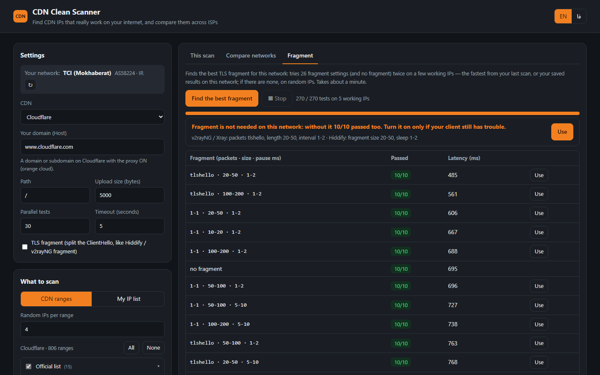
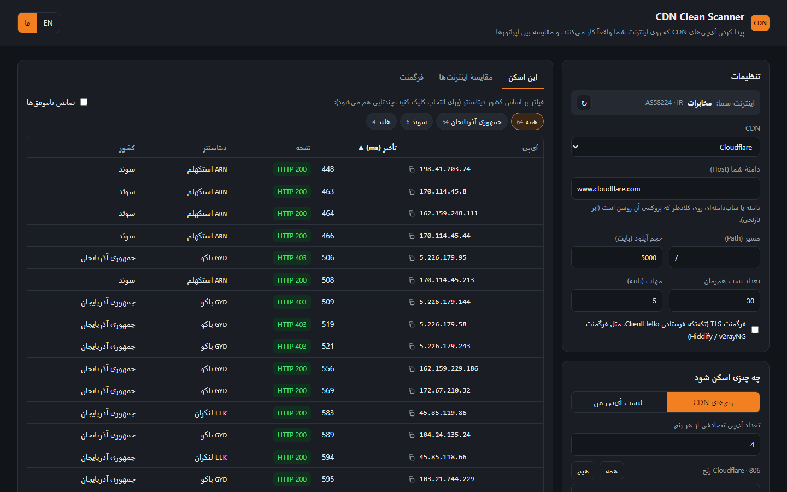
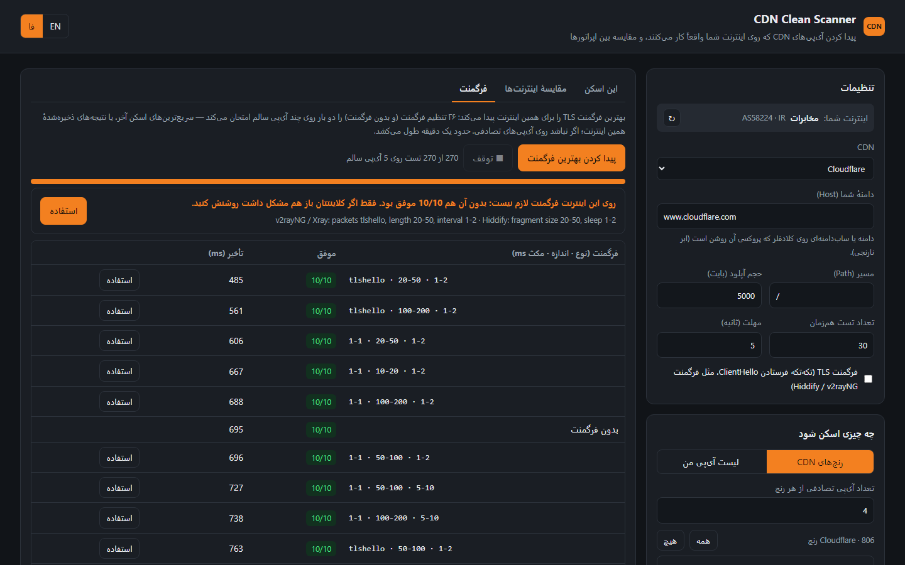

# CDN Clean Scanner

<a href="https://hits.sh/github.com/Plus98ir/CDN-Clean-Scanner/"></a>
<a href="https://github.com/Plus98ir/CDN-Clean-Scanner/releases/latest"></a>

**[English](#english) · [فارسی](#فارسی)** · Website: https://plus98ir.dpdns.org/CDN-Clean-Scanner/



## English

**The professional clean-IP scanner for Cloudflare, Fastly, Gcore and Amazon CloudFront.** It tests every IP with **real traffic** on your own internet, shows **which IP works on which ISP** (MCI, Irancell, TCI, RighTel…), finds the **best TLS fragment** setting for your network, and puts the clean IPs straight into your **Hiddify or 3x-ui** panel.

A ping is not enough: some ISPs let the ping and TLS handshake through, then cut the connection after ~1.3 KB of upload. This scanner opens TLS to each IP with your own domain as SNI and sends a real upload (5 KB by default). Only IPs that answer are kept.

### Download

| | Download | |
|---|---|---|
| **Windows** | [CDN-Clean-Scanner.exe](https://github.com/Plus98ir/CDN-Clean-Scanner/releases/latest/download/CDN-Clean-Scanner.exe) | double-click; no Python needed |
| **Android** | [CDN-Clean-Scanner.apk](https://github.com/Plus98ir/CDN-Clean-Scanner/releases/latest/download/CDN-Clean-Scanner.apk) | allow "install unknown apps"; no root |

The app checks for new builds by itself and shows a banner (plus a notification on Android) with the list of changes.

### Features

| | |
|---|---|
| ⬆️ **Real upload test** | TLS with your domain as SNI + a real upload; IPs that only pass the handshake are dropped. |
| 📶 **Per-ISP results** | The ISP is detected by AS number and every result is saved under it. *Compare networks* has one column per ISP. |
| 🧩 **TLS fragment** | Sends the ClientHello in pieces (`tlshello` or TCP `1-1`, like v2rayNG / Xray / Hiddify) so DPI can't read the SNI. |
| 🎯 **Best-fragment finder** | Tries 26 fragment settings and no fragment on working IPs, picks the best and prints the client values. |
| 🛰️ **Hiddify / 3x-ui panels** | Loads the panel's domains / configs with their path, builds the best IPs per ISP and writes them in one click. |
| 🌐 **4 CDNs, ~1400 ranges** | Official lists plus every prefix each CDN announces. |
| 📍 **Datacenter city & country** | From CF-RAY / X-Served-By / X-Amz-Cf-Pop; filter by country, *Find more* tests /24 neighbours. |
| 🔒 **Local and private** | Runs on 127.0.0.1 only. Panel links, tokens and passwords are used for that request only. |

### Fragment

1. Scan normally to find some working IPs (if none pass, tick **TLS fragment** and scan again).
2. In the **Fragment** tab press **Find the best fragment** (about a minute).
3. The best setting is shown with ready values; **Use** applies it to your next scans. If everything also passes without fragment, it says so.

```
v2rayNG / Xray : packets tlshello · length 20-50 · interval 1-2
Hiddify        : fragment size 20-50 · sleep 1-2
```

### Send the IPs to your panel

In *Compare networks* → **Send to a panel**:

- **Hiddify:** paste your admin link. Every domain is listed with its mode and whether DNS points to a CDN. The IPs go into the CDN IP field as `IP ISP` pairs, so Hiddify gives each user the IP of their own ISP.
- **3x-ui (Sanaei):** panel address + **API token** (Settings → Security → API Token) or user name and password. The ws / httpupgrade / xhttp / grpc configs are listed with domain and path. The IPs go into that config's **External Proxy** list (one config per IP in the subscription, named after its ISP); clients and other settings are not touched.
- **Use for scanning** copies a config's domain and path into the scan settings.

**Turn off your VPN before scanning**, otherwise you test the VPN, not your ISP. If Windows SmartScreen warns, click *More info → Run anyway* (the exe is not code-signed).

### Screenshots

| Scan results | Best-fragment finder |
|---|---|
|  |  |

## فارسی

<div dir="rtl">

**اسکنر حرفه‌ای آی‌پی تمیز برای Cloudflare، Fastly، Gcore و Amazon CloudFront.** هر آی‌پی را با **ترافیک واقعی** روی اینترنت خود شما تست می‌کند، نشان می‌دهد **هر آی‌پی روی کدام اپراتور** کار می‌کند (همراه اول، ایرانسل، مخابرات، رایتل و …)، **بهترین تنظیم فرگمنت** را برای اینترنت شما پیدا می‌کند و آی‌پی‌های تمیز را مستقیم در پنل **Hiddify یا 3x-ui** می‌نویسد.

پینگ کافی نیست: بعضی اپراتورها اجازه می‌دهند پینگ و هندشیک TLS رد شود، اما بعد از حدود ۱٫۳ کیلوبایت آپلود اتصال را قطع می‌کنند. این اسکنر با دامنهٔ خودتان به‌عنوان SNI به هر آی‌پی وصل می‌شود و یک آپلود واقعی (پیش‌فرض ۵ کیلوبایت) می‌فرستد. فقط آی‌پی‌هایی که جواب بدهند نگه داشته می‌شوند.

### دانلود

- **ویندوز:** [CDN-Clean-Scanner.exe](https://github.com/Plus98ir/CDN-Clean-Scanner/releases/latest/download/CDN-Clean-Scanner.exe) را دانلود کنید و رویش دوبار کلیک کنید؛ پایتون لازم نیست. اگر ویندوز هشدار داد، More info و بعد Run anyway را بزنید.
- **اندروید:** [CDN-Clean-Scanner.apk](https://github.com/Plus98ir/CDN-Clean-Scanner/releases/latest/download/CDN-Clean-Scanner.apk) را نصب کنید (اجازهٔ نصب از منابع ناشناس را بدهید؛ روت لازم نیست). اگر اجازهٔ اعلان خواست، Allow بزنید.

برنامه خودش نسخهٔ جدید را چک می‌کند و با بنر (و روی اندروید با اعلان) همراه لیست تغییرات خبر می‌دهد.

قبل از اسکن **فیلترشکن را خاموش کنید**؛ وگرنه فیلترشکن تست می‌شود، نه اینترنت شما.

### امکانات

- ⬆️ **تست با آپلود واقعی:** آی‌پی‌هایی که فقط هندشیک را رد می‌کنند حذف می‌شوند.
- 📶 **نتیجه برای هر اپراتور:** اپراتور با شمارهٔ AS خودکار تشخیص داده می‌شود؛ در «مقایسهٔ اینترنت‌ها» هر اپراتور یک ستون است.
- 🧩 **فرگمنت TLS:** ارسال تکه‌تکهٔ ClientHello (حالت `tlshello` یا TCP `1-1`، مثل v2rayNG و Hiddify) تا DPI نتواند SNI را بخواند.
- 🎯 **پیدا کردن بهترین فرگمنت:** ۲۶ تنظیم فرگمنت و حالت بدون فرگمنت را امتحان می‌کند و بهترین را با مقدارهای آمادهٔ کلاینت می‌دهد.
- 🛰️ **پنل Hiddify و 3x-ui:** دامنه‌ها و کانفیگ‌ها را با path خودکار می‌آورد و بهترین آی‌پی‌های هر اپراتور را با یک کلیک در پنل می‌نویسد.
- 🌐 **۴ CDN و حدود ۱۴۰۰ رنج**، 📍 **شهر و کشور دیتاسنتر** با فیلتر کشور و «پیدا کردن بیشتر».
- 🔒 **کاملاً محلی:** فقط روی 127.0.0.1 اجرا می‌شود؛ لینک، توکن و رمز پنل فقط برای همان درخواست استفاده می‌شوند.

### فرگمنت

۱. یک اسکن معمولی بزنید تا چند آی‌پی سالم پیدا شود (اگر هیچ‌کدام رد نشد، تیک «فرگمنت TLS» را بزنید و دوباره اسکن کنید).<br>
۲. در تب **فرگمنت**، «پیدا کردن بهترین فرگمنت» را بزنید (حدود یک دقیقه).<br>
۳. بهترین تنظیم با مقدارهای آماده نشان داده می‌شود؛ «استفاده» آن را برای اسکن‌های بعدی تنظیم می‌کند. اگر بدون فرگمنت هم همه رد شوند، همین را می‌گوید.

### ارسال آی‌پی‌ها به پنل

در تب «مقایسهٔ اینترنت‌ها»، بخش **ارسال به پنل**:

- **Hiddify:** لینک ادمین را بدهید. همهٔ دامنه‌ها با حالتشان می‌آیند و مشخص می‌شود کدام پشت CDN است. آی‌پی‌ها به‌شکل «IP اپراتور» در فیلد CDN IP نوشته می‌شوند و هیدیفای به هر کاربر آی‌پی اپراتور خودش را می‌دهد.
- **3x-ui (ثنایی):** آدرس پنل و **توکن API** (تنظیمات ← امنیت ← API Token) یا نام کاربری و رمز. کانفیگ‌های ws، httpupgrade، xhttp و grpc با دامنه و path می‌آیند. آی‌پی‌ها در **External Proxy** همان کانفیگ نوشته می‌شوند (در ساب، برای هر آی‌پی یک کانفیگ با اسم اپراتورش)؛ کلاینت‌ها و بقیهٔ تنظیمات دست نمی‌خورند.
- «استفاده برای اسکن» دامنه و path همان کانفیگ را در تنظیمات اسکن می‌نویسد.

### مقایسهٔ اپراتورها

۱. روی اینترنت اول (مثلاً وای‌فای مخابرات) یک اسکن معمولی انجام دهید.<br>
۲. به اینترنت دیگری وصل شوید (مثلاً هات‌اسپات گوشی با سیم‌کارت همراه اول) و دکمهٔ ↻ کنار «اینترنت شما» را بزنید.<br>
۳. در تب «مقایسهٔ اینترنت‌ها» دکمهٔ «تست همین‌ها روی این اینترنت» را بزنید.<br>
۴. برای ایرانسل و بقیه تکرار کنید. با کلیک روی نام اپراتورها فقط آی‌پی‌هایی می‌مانند که روی همهٔ آن‌ها کار می‌کنند.

### تصاویر

</div>

| نتیجهٔ اسکن | پیدا کردن بهترین فرگمنت |
|---|---|
|  |  |
